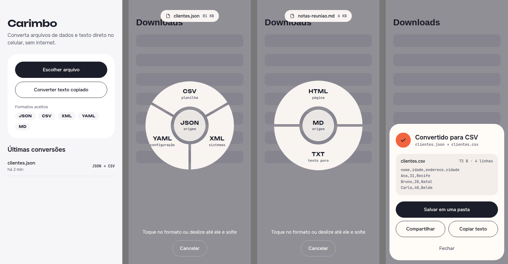
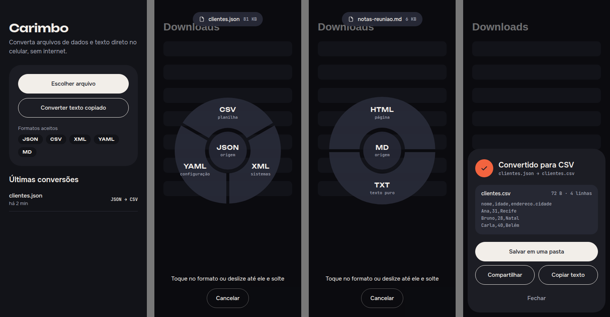

# Carimbo

Offline file converter for Android. Share a file from any app and a radial menu floats over that app, showing only the formats the file can become. Slide your finger to one and let go, and the converted file is ready to save, share or copy.





## What it converts

| From \ To | JSON | CSV | XML | YAML | HTML | TXT |
|---|---|---|---|---|---|---|
| JSON | – | ✓ | ✓ | ✓ | | |
| CSV | ✓ | – | ✓ | ✓ | | |
| XML | ✓ | ✓ | – | ✓ | | |
| YAML | ✓ | ✓ | ✓ | – | | |
| Markdown | | | | | ✓ | ✓ |

Everything runs on the device. No file is uploaded anywhere.

## Ways in

- **Choose file** inside the app
- **Convert copied text** from the clipboard
- **Share** from any app (Files, Drive, WhatsApp, e-mail)
- **Open with** from a file manager

The format is detected from extension, MIME type and content, so a `.txt` that contains JSON is treated as JSON.

## Architecture

```
src/
  core/         pure TypeScript, no React or Android imports
    formats.ts    supported formats catalog
    detect.ts     format detection (extension + MIME + content)
    registry.ts   converter registry, answers "where can this file go?"
    convert.ts    orchestration, limits and errors
  converters/   conversion modules, plugged in at converters/index.ts
    data/         JSON, CSV, XML, YAML codecs
    text/         Markdown converters
  platform/     everything Android-specific (files, share, clipboard, storage)
  ui/           theme tokens, components and screens
  i18n/         all user-facing text (pt-BR, en)
  app/          App.tsx: state machine wiring everything together
```

**Pivot format.** Data formats don't convert to each other directly. Each one implements a `DataCodec` with `parse` (text to an intermediate `DataValue`) and `serialize` (back to text). The registry combines them automatically, so adding a format takes 2 functions instead of one converter per pair.

**Adding a module** (images, for example): create `src/converters/image/`, export converters that follow the `Converter` interface, and register them in `src/converters/index.ts`. Screens pick up the new targets on their own.

**Floating wheel.** `plugins/withFloatingWindow.js` makes the Android window translucent (and blurs the app behind it on Android 12+), so the wheel opened from Share or Open with appears on top of the app the file came from. The wheel geometry lives in `src/ui/components/wheelGeometry.ts` and is unit-tested.

**Errors** carry only a code and details (like a line number). The text shown to the user lives in `src/i18n`.

## Running

```bash
npm install
npm test            # converter and detection tests
npm run typecheck
```

Every push runs `.github/workflows/android-apk.yml`: tests, `expo prebuild`, a Gradle release build, and a GitHub Release named **latest** with `carimbo.apk` attached. No Expo account or local Android SDK needed.

## Stack

Expo SDK 58, React Native, TypeScript, papaparse, fast-xml-parser, js-yaml, marked, Vitest.

## License

MIT
